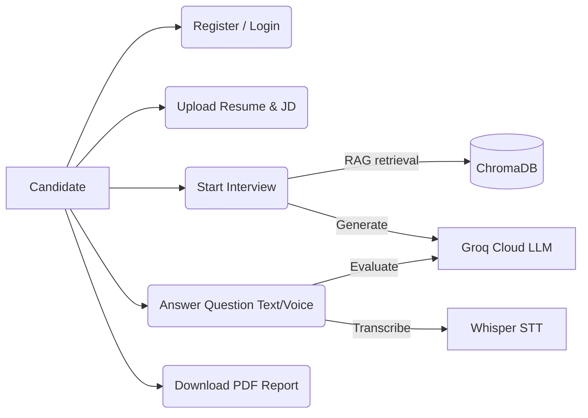
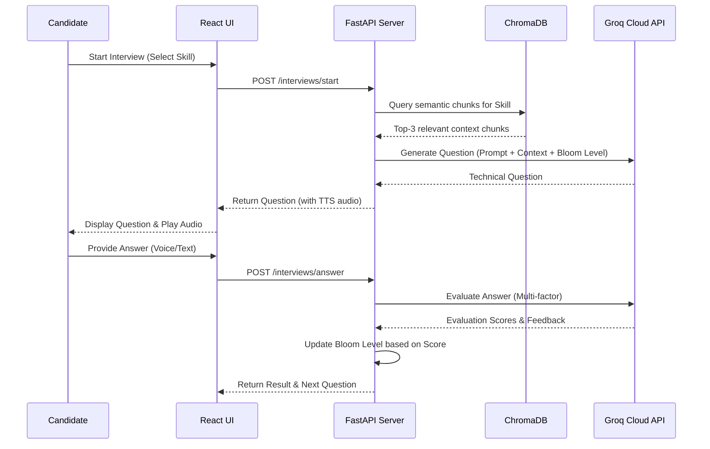
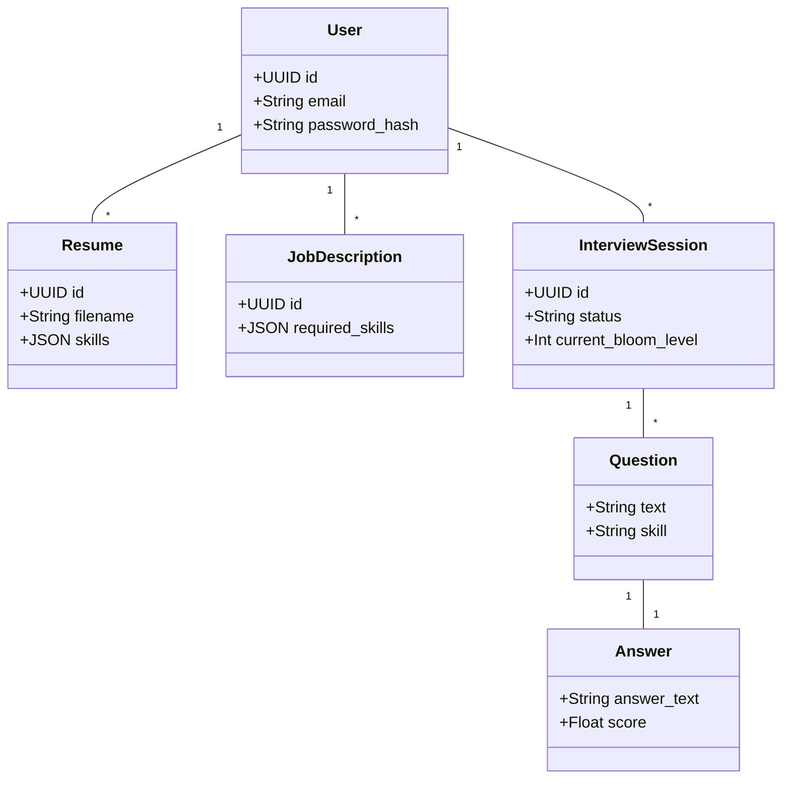
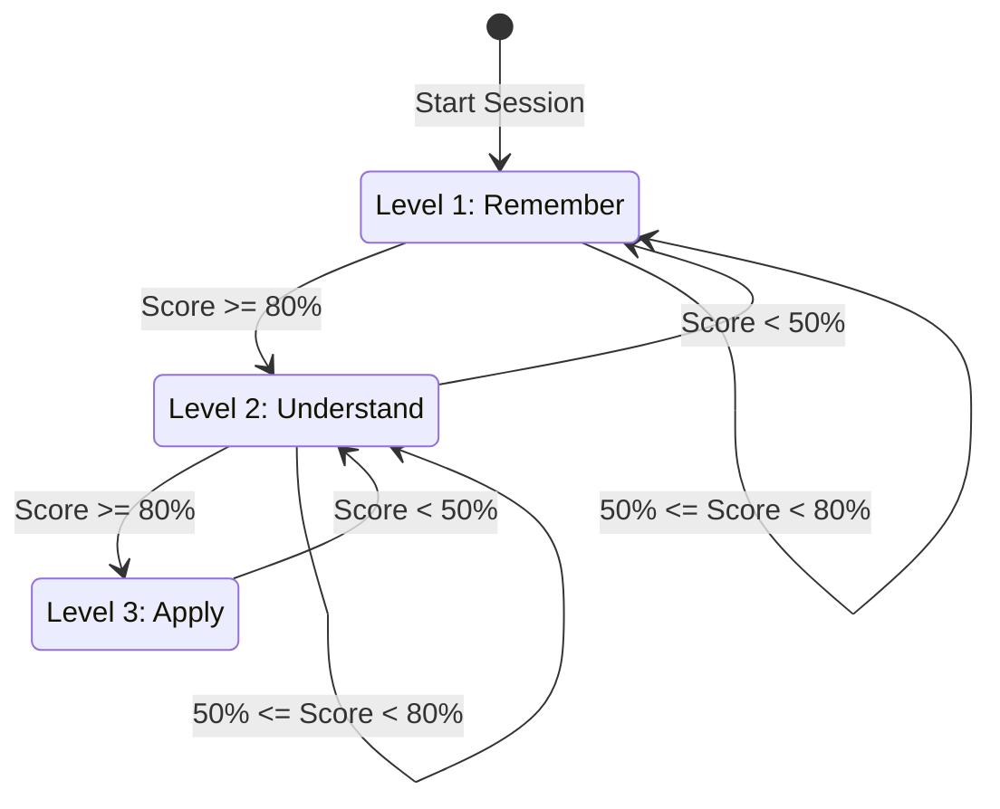
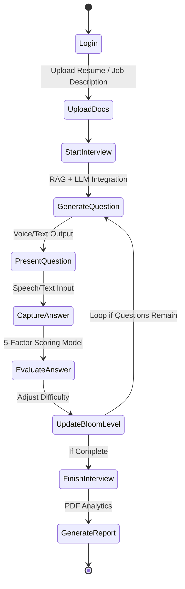
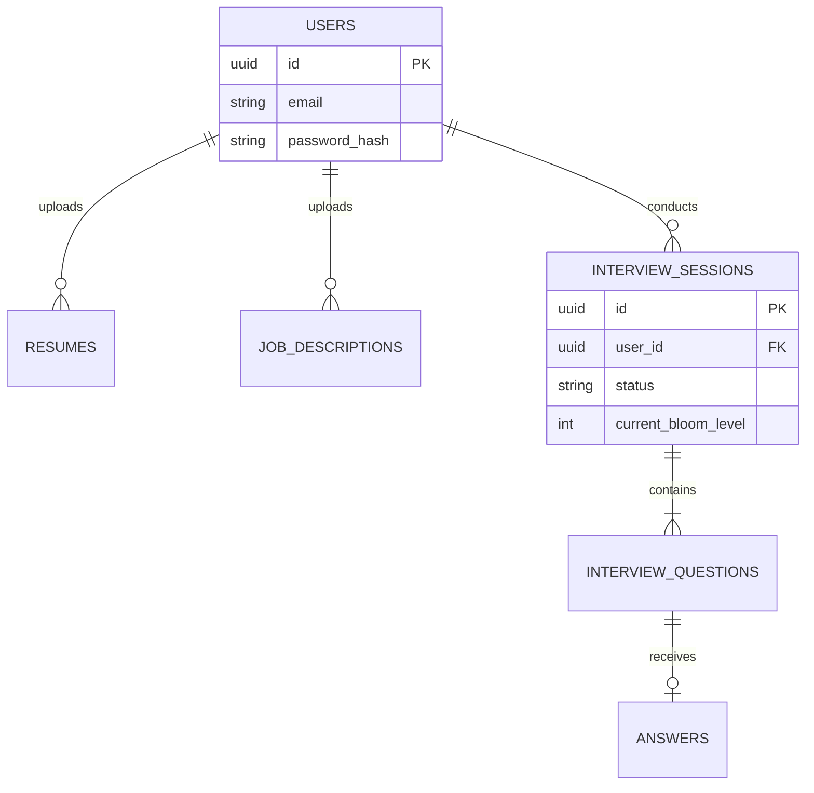
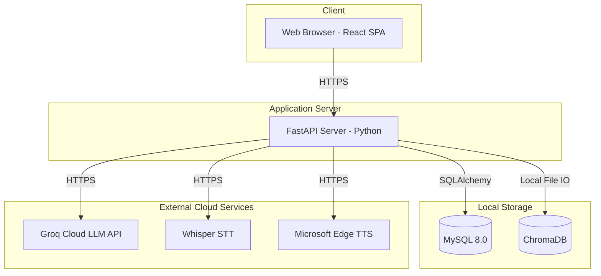

# Software Requirement Specification (SRS)

## Personalized Technical Interview Preparation in Higher Education (SmartInterview-G1392)

**Project Team ID: Team G-1392**
1. Shamakura Saiteja Goud - 24BD1A665K
2. Thodsam Srujan - 24BD1A665R
3. Vasireddy Vignesh Reddy - 24BD1A665X
4. Aelugu Ranith Kumar - 25BD5A6615
5. Konduri Abhiram - 25BD5A6620

**Project Mentor:** Dr. TVG Sridevi
**Department:** Computer Science and Engineering (AI & ML)
**Institution:** Keshav Memorial Institute of Technology (KMIT)

---

## Problem Statement
In modern technical recruitment, graduating engineering students face severe preparation barriers including static question banks, anxiety during live technical interviews, lack of personalized feedback, and complete disconnect between university curricula, candidate resumes, and dynamic industry job descriptions. Existing mock interview platforms rely on rigid question sets or ungrounded generative AI bots that hallucinate questions, exhibit significant conversational latency, and lack systematic evaluation methodologies.

When candidates prepare for specific software engineering roles, their target job descriptions require specific technical skillsets—spanning Data Structures, System Design, Operating Systems, Database Management Systems, Computer Networks, and Machine Learning. Static platforms fail to compare candidate resumes against targeted job descriptions to identify exact role overlap and critical skill deficiencies.

Furthermore, traditional evaluation mechanisms fail to measure cognitive depth. When an interview question is presented, candidate responses must be evaluated across multiple technical dimensions—including technical correctness, completeness, conceptual coverage, semantic relevance, and communication clarity. Without dynamic difficulty scaling based on validated educational frameworks, candidates cannot assess their true interview readiness or receive actionable remediation paths.

To overcome these limitations, SmartInterview provides an AI-powered, RAG-grounded adaptive technical mock interview platform. By integrating dense vector retrieval with Bloom's Taxonomy cognitive progression, multi-signal response evaluation, in-memory neural text-to-speech, and automatic speech recognition transcription, the system delivers an authentic, personalized, low-latency interview preparation experience.

---

## 1. Introduction

### 1.1 Purpose
This document specifies the software requirements for Personalized Technical Interview Preparation in Higher Education. The system automates the technical interview preparation lifecycle for engineering candidates. It provides personalized interview sessions grounded in domain-specific computer science knowledge, adjusts question difficulty dynamically based on candidate performance, delivers spoken voice output, transcribes verbal answers, and produces comprehensive analytical evaluation reports.

### 1.2 Product Scope
SmartInterview is an intelligent web-based application designed to bridge the preparation gap between university education and software industry hiring expectations. The platform provides continuous 24x7 self-directed interview practice. Unlike generic chat interfaces, SmartInterview grounds interview content in an authoritative local vector store of curated computer science topics across core technical domains. 

The system analyzes candidate resumes and target job descriptions to compute skill overlap and role deficiencies, conducts dynamic multi-turn technical interviews across Bloom's Taxonomy cognitive tiers, evaluates answers across 5 technical and semantic criteria, adjusts subsequent question difficulty, and provides spoken voice delivery alongside a downloadable performance evaluation report.

### 1.3 References
1. Reimers & Gurevych (2019), "Sentence-BERT: Sentence Embeddings using Siamese BERT-Networks."
2. Lewis et al. (2020), "Retrieval-Augmented Generation for Knowledge-Intensive NLP Tasks."
3. Anderson & Krathwohl (2001), "A Taxonomy for Learning, Teaching, and Assessing: A Revision of Bloom's Taxonomy."
4. Radford et al. (2023), "Robust Speech Recognition via Large-Scale Weak Supervision" (OpenAI Whisper).
5. Groq Inc. (2024), Language Processing Unit (LPU) Hardware Architecture.
6. FastAPI and React.js Documentation.

---

## 2. Overall Description

### 2.1 Product Perspective
SmartInterview is an independent, self-contained three-tier web application integrated with local vector retrieval and high-speed cloud inference. The presentation tier consists of a responsive React single-page application; the application tier is powered by a FastAPI backend running under Uvicorn ASGI; the persistence tier utilizes a relational MySQL database for user accounts and session records, and an embedded ChromaDB instance for vector embeddings.

### 2.2 Product Functions
- User registration, authentication with JWT, and profile management.
- Resume upload (PDF) with automated section parsing and skill extraction.
- Job description upload (PDF) with Group A (Role Overlap) and Group B (Role Gap) mapping.
- Interactive technical mock interviews with real-time text and speech input options.
- Domain-filtered semantic retrieval from curated computer science chunks (RAG).
- Bloom-levelled single-question generation powered by LLM.
- Deterministic adaptive progression adjusting difficulty and cognitive depth after each response.
- In-memory neural text-to-speech question synthesis.
- Speech-to-text audio transcription via Whisper API.
- Instant multi-signal performance scoring (Correctness, Completeness, Relevance, Semantic Similarity via S-BERT, and Concept Coverage).
- Comprehensive performance dashboard and downloadable PDF report.

### 2.3 Operating Environment
- **Client:** Modern web browser (Chrome, Edge, Firefox, Safari) on Windows, macOS, or Linux. Requires a working microphone interface.
- **Server Runtime:** Python 3.10+ (FastAPI, Uvicorn, SQLAlchemy), Node.js (React, Vite, Tailwind CSS).
- **Database:** MySQL Server 8.0+ and ChromaDB (Local HNSW store).
- **AI Infrastructure:** Groq Cloud API and Microsoft edge-tts.

---

## 3. Specific Requirements

### 3.1 Functional Requirements
- **RI.01.01 Candidate Account Registration:** Secure registration with bcrypt password hashing.
- **RI.01.02 Candidate Authentication:** Issue HS256-signed JWTs valid for 24 hours.
- **RI.01.03 Resume Ingestion & PDF Parsing:** Extract skills and experience using PyMuPDF.
- **RI.01.04 Job Description Upload & Role Extraction:** Parse required qualifications and technical responsibilities.
- **RI.01.05 Skill Overlap and Gap Mapping:** Compute intersection/difference to identify overlapping skills and gaps.
- **RI.01.06 RAG-Grounded Bloom-Adaptive Question Generation:** Retrieve top context chunks from ChromaDB and prompt the LLM to generate exactly one contextual technical question.
- **RI.01.07 Multi-Signal 5-Factor Answer Evaluation:** Produce an overall score based on Technical Correctness (30%), Completeness (20%), Relevance (20%), Semantic Similarity via SentenceTransformers (15%), and Concept Coverage (15%).
- **RI.01.08 Deterministic Adaptive State Progression:** Score >= 80% advances Bloom level (+1); 50% <= Score < 80% maintains level; Score < 50% regresses Bloom level (-1).
- **RI.01.09 Neural Text-to-Speech Question Streaming:** Synthesize and stream audio in-memory to the client.
- **RI.01.10 Whisper Speech-to-Text Answer Transcription:** Accept recorded audio and return verbatim transcribed text.
- **RI.01.11 Downloadable PDF Interview Report:** Generate a comprehensive post-interview report detailing performance and progression.

### 3.2 Non-Functional Requirements
- **Performance:** Semantic Search Latency <= 100ms. LLM Generation Latency <= 2.5 seconds. TTS Streaming Latency <= 1.2 seconds.
- **Security:** JWT authentication, bcrypt password storage, and rigorous file upload sanitization (<= 5MB).
- **Robustness:** Fallback text input in case of microphone failure; API key decoupling.

---

## Software Development Life Cycle (SDLC)
The Software Development Life Cycle (SDLC) followed for SmartInterview is the Agile/Iterative Methodology. 
- **Stage 1 (Planning & Requirement Analysis):** Feasibility study on deploying local vector embeddings vs. cloud models to minimize latency. 
- **Stage 2 (Defining Requirements):** Formulation of this SRS to lock in functional scopes like Bloom's scaling and RAG indexing.
- **Stage 3 (Designing Product Architecture):** Establishing a decoupled 3-tier structure (React SPA, FastAPI, MySQL + ChromaDB).
- **Stage 4 (Building):** Implementation of modular microservices (Auth, Resume Parsing, RAG Querying, TTS/STT integration).
- **Stage 5 (Testing):** Unit testing of scoring rubrics and semantic similarity thresholds to ensure accuracy.
- **Stage 6 (Deployment):** Staging behind a Uvicorn ASGI server and exposing client endpoints.

---

## Literature Survey
1. **Sentence-BERT (Reimers & Gurevych, 2019):** Modified pre-trained BERT networks using siamese and triplet structures for deriving semantically meaningful sentence embeddings. Applied in SmartInterview for local high-speed semantic similarity scoring.
2. **Retrieval-Augmented Generation (Lewis et al., 2020):** Combined parametric memory with non-parametric memory to reduce hallucinations. SmartInterview uses this to ground the Groq LLM against a curated ChromaDB of 400+ CS topics.
3. **Bloom's Taxonomy (Anderson & Krathwohl, 2001):** Revised cognitive taxonomy (Remember, Understand, Apply, Analyze, Evaluate, Create) utilized as the deterministic state machine for interview progression.
4. **OpenAI Whisper (Radford et al., 2023):** State-of-the-art zero-shot STT, integrated into SmartInterview for real-time technical term transcription.
5. **Language Processing Unit (Groq Inc., 2024):** High-speed tensor processing architecture allowing the application to achieve sub-second LLM inference times during live conversations.

---

## 4. System Designing & UML Diagrams

### 4.1 Use Case Diagram

### 4.2 Sequence Diagram: Interview Session & Evaluation

### 4.3 Class Diagram

### 4.4 Statechart Diagram (Bloom's Taxonomy Progression)

### 4.5 Activity Diagram (End-to-End Lifecycle)

### 4.6 Entity Relationship Diagram (ERD)

### 4.7 Deployment Diagram

---

## 5. Implementation
- **Frontend Architecture:** React 18/19, Vite, Tailwind CSS v4, Context API for state management.
- **Backend Services:** FastAPI 0.115, Python 3.10+, Uvicorn ASGI, modular routing (auth, resumes, evaluation).
- **Vector Grounding (RAG):** ChromaDB 0.6.3 storing pre-indexed computer science chunks. Embeddings generated via SentenceTransformers `all-MiniLM-L6-v2`.
- **Generative AI & Inference:** Groq Cloud LPU architecture for high-speed inference.
- **Voice Processing Subsystem:** Microsoft edge-tts for speech synthesis and Whisper-large-v3 for transcription.

---

## 6. Testing (Validation & Verification)
**Software Validation:** Ensures the platform satisfies user needs. Tests confirmed that candidates can seamlessly upload a resume and JD, triggering an interview accurately mapped to their role overlapping and gap areas.
**Software Verification:** Confirms adherence to design. Evaluated API schemas, foreign key constraints in MySQL, and mathematical verification of the 5-factor weighting formula.

| Test ID | Module | Scenario | Expected Result | Status |
|---|---|---|---|---|
| TC-01 | Auth | Register duplicate user | HTTP 400 Bad Request | PASSED |
| TC-02 | Resume | Upload invalid file type | HTTP 400 Rejected | PASSED |
| TC-03 | RAG | Retrieve context for 'SQL' | Top-3 chunks returned | PASSED |
| TC-04 | Adaptive | Score >= 80% | Bloom tier advances (+1) | PASSED |
| TC-05 | Adaptive | Score < 50% | Bloom tier regresses (-1)| PASSED |
| TC-06 | Voice | Synthesize TTS stream | Audio byte stream OK | PASSED |

---

## 7. Conclusion
SmartInterview successfully demonstrates the integration of Retrieval-Augmented Generation (RAG) with a deterministic adaptive learning engine based on Bloom's Revised Taxonomy, resolving the fundamental flaws of static question banks and hallucinatory AI interview bots. By enforcing domain-filtered retrieval across curated computer science topics, the system guarantees technical grounding. The hybrid 5-signal evaluation architecture provides objective, transparent scoring, delivering a robust, accessible, and pedagogically sound interview preparation experience.
