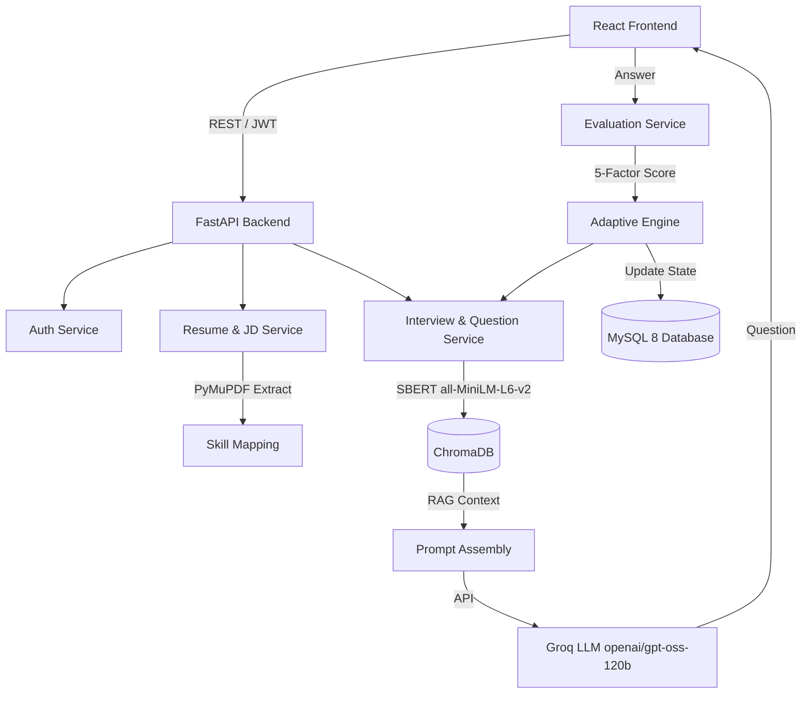

# SmartInterview: Project Dossier

## A. PROJECT IDENTITY
- **Project Title:** SmartInterview
- **Alternative Names:** AI-Powered Adaptive Mock Interview Platform
- **Description:** SmartInterview is an advanced, full-stack application designed to simulate open-ended, technical mock interviews. It uses an adaptive learning engine based on Bloom’s Taxonomy to dynamically adjust question difficulty and cognitive level based on real-time candidate performance. It features a Retrieval-Augmented Generation (RAG) vector knowledge base to prevent LLM hallucinations, and a multi-signal answer evaluation system.
- **Project Type/Domain:** AI-Powered EdTech / Technical Mock Interview Platform / Web App
- **Programming Languages Used:** 
  - Approximate breakdown by file count: Python (87 files), JavaScript/JSX/TypeScript (20 files), HTML/CSS (52 files), SQL (7 files). Thus, primarily a Python/React stack.
- **Date Range of Development:** September 16, 2026 to October 27, 2026 (Continuous 18-Phase Engineering & Production Release).
- **Project Team:** Team G-1392 (Konduri Abhiram, Shamakura Saiteja Goud, Thodsam Srujan, Vasireddy Vignesh Reddy, Aelugu Ranith Kumar) mentored by Dr. TVG Sridevi, KMIT.


## B. PROBLEM AND MOTIVATION
- **Problem:** Technical interview preparation relies on static, non-adaptive problem repositories (which fail to adjust to cognitive depth) or resource-intensive human mock interviews (which lack scalability). Unconstrained LLM bots frequently hallucinate and lack pedagogical structure.
- **Target Users:** Software engineering candidates transitioning from academic study to professional industry roles, and university students.
- **Objectives:** Implement deterministic PDF parsing for Resume & JD extraction, Domain-Filtered Vector Grounding, Cognitive Taxonomy Question Generation, Multi-Factor Answer Scoring, Deterministic Adaptive State Machine, and an Academic Syllabus Mode.
- **Related Work Referenced:** Static Platforms (LeetCode, HackerRank, GeeksforGeeks), Human Mock Platforms (Pramp, Interviewing.io), Generic AI Chatbots (ChatGPT, Claude).

## C. SYSTEM ARCHITECTURE
- **High-Level Architecture:**
  - **Frontend:** React 18 / Vite UI for candidate interaction, resume/JD upload, and performance dashboards.
  - **FastAPI Backend:** Handles business logic and coordinates services. Contains Routers (`auth`, `resumes`, `job_descriptions`, `interviews`, `users`).
  - **Auth Service:** Stateless JWT (HS256) and bcrypt hashing.
  - **Resume & JD Service:** Uses PyMuPDF to extract text, detects section boundaries via regex, and maps canonical skills.
  - **Vector Database (ChromaDB):** Stores domain-filtered computer science chunks (`technical_kb`) for RAG.
  - **Evaluation Service:** Uses Groq Cloud LLM and SentenceTransformers to calculate a 5-factor evaluation score.
  - **Adaptive Engine:** Python-based state machine that governs Bloom’s Taxonomy progression based on scores.
  - **Database (MySQL 8):** Persists stateless sessions, evaluations, and user metadata.
- **Data Flow:** 
  User uploads Resume & JD -> Backend extracts skills -> Skills mapped (Group A / Group B) -> Candidate starts interview -> System selects skill -> ChromaDB queries related text chunks via SBERT -> Prompt sent to Groq LLM -> Question presented to User -> User submits answer -> Evaluated across 5 dimensions (LLM + SBERT + coverage) -> Score updates AdaptiveState (Bloom level and difficulty adjust) -> Next question.
- **Folder/File Tree (Top 3 Levels):**
  - `/backend` (FastAPI backend)
    - `/app` (Core logic: `main.py`, `/models`, `/routers`, `/services`)
    - `/chroma_db` (Persistent vector store)
    - `/scripts` (Standalone scripts)
  - `/frontend` (React 18 / Vite UI)
    - `/src` (React components, pages, context, styles)
    - `/public` (Static assets like logo)
  - `/docs` (Documentation: markdown and word documents)
- **Mermaid Diagram (Architecture & Data Flow):**


## D. TECH STACK
| Framework / Tool | Version | Purpose |
|---|---|---|
| **React** | ^18.3.1 | Frontend UI Library |
| **Vite** | ^6.1.1 (or ^8.2.2 via package.json) | Frontend Build Tool & Dev Server |
| **Tailwind CSS** | ^4.3.3 | UI Styling |
| **FastAPI** | 0.115.0 | Backend REST API Framework |
| **Uvicorn** | 0.30.0 | ASGI Web Server |
| **SQLAlchemy** | 2.0.35 | Database ORM |
| **PyMySQL** | 1.1.1 | MySQL Driver |
| **ChromaDB** | 0.6.3 | Persistent Local Vector Database |
| **Groq API** | - | Cloud LLM Inference Engine |
| **SentenceTransformers** | 3.4.1 | Local Dense Embeddings |
| **PyMuPDF (fitz)** | 1.24.0+ | PDF Document Extraction |
| **edge-tts** | - | Offline-capable Microsoft Neural TTS |
| **reportlab** | - | Automatic PDF Report Generation |
| **MySQL Server** | 8.0+ | Relational Database Storage |

- **Development Environment:** Python 3.10+, Node.js 18+. Runs locally with zero-budget hardware (Intel Core i5 / AMD Ryzen 5, 8 GB RAM, 5 GB storage). Internet connectivity required only for Groq cloud API.

## E. DATA
- **Dataset Name:** `technical_kb` (Curated Computer Science Knowledge Base)
- **Source/License:** Internally curated, stored in `data/processed/`.
- **Number of Samples:** 402 chunks, 50 concepts, 8 domains (`cn`, `dbms`, `design-patterns`, `dsa`, `ml-dl`, `oop`, `os`, `system-design`).
- **File Formats:** SQLite/Parquet (within ChromaDB).
- **Preprocessing Steps:** Token count bounded between 50 and 400 tokens (average 195.47). Globally unique ID assigned to each chunk (`<domain>_<concept>_<index:03d>`).

## F. METHODOLOGY / IMPLEMENTATION
- **Algorithms / Techniques:**
  - **Retrieval-Augmented Generation (RAG):** Uses `all-MiniLM-L6-v2` (384 dimensions) for top-3 semantic retrieval via ChromaDB, filtered by specific technical domains.
  - **Bloom’s Taxonomy State Machine:** Python logic strictly manages progression (Score >= 80 -> advance Bloom level; Score < 50 -> regress Bloom level) independently of LLM.
  - **Multi-Factor Scoring Engine:** Overall Score = 0.30(Technical) + 0.20(Completeness) + 0.20(Relevance) + 0.15(Semantic Similarity via SBERT) + 0.15(Concept Coverage).
  - **Skill Mapping Priority:** Group A (JD ∩ Resume) tested first, Group B (JD - Resume) tested next.
- **Model Details:** Groq Cloud `openai/gpt-oss-120b` for generative tasks (temperature 0.7 for questions, 0.3 for evaluation).
- **Important Code Snippets:**

**1. Scoring Formula Weights (`backend/app/services/evaluation_service.py`)**
```python
# ── Scoring Weights (documented) ─────────────────────────────
WEIGHT_TECHNICAL = 0.30
WEIGHT_COMPLETENESS = 0.20
WEIGHT_RELEVANCE = 0.20
WEIGHT_SEMANTIC_SIMILARITY = 0.15
WEIGHT_CONCEPT_COVERAGE = 0.15
```
*Explanation: Defines the exact constant multipliers used to calculate a candidate's overall answer score out of 100, combining AI critique with deterministic semantic and coverage checks.*

**2. Adaptive Progression Thresholds (`backend/app/services/adaptive_engine.py`)**
```python
# Adaptive score thresholds
ADVANCE_THRESHOLD = 80   # Score >= 80 → progress
MAINTAIN_LOWER = 50      # Score 50-79 → maintain
# Score < 50 → regress/reinforce
```
*Explanation: Defines the strict deterministic cutoffs for adjusting question difficulty and cognitive Bloom level based on the evaluation score.*

**3. Bloom Taxonomy Question Types (`backend/app/services/adaptive_engine.py`)**
```python
BLOOM_QUESTION_TYPES = {
    "remember":    ["conceptual", "practical", "technical_reasoning"],
    "understand":  ["conceptual", "technical_reasoning", "practical"],
    "apply":       ["practical", "conceptual", "scenario"],
    "analyze":     ["technical_reasoning", "practical", "scenario"],
    "evaluate":    ["scenario", "technical_reasoning", "project"],
    "create":      ["project", "scenario", "practical"],
}
```
*Explanation: Maps cognitive Bloom levels (Remember to Create) to the specific types of questions the LLM will be instructed to generate.*

**4. JD Skill Grouping Strategy (`backend/app/services/jd_service.py`)**
```python
# Skill mapping priority:
# Priority 1 (Group A): JD skills that ARE in Resume  → verify claimed experience
# Priority 2 (Group B): JD skills NOT in Resume       → test role requirement/gap
# Resume-only skills   → NOT included in default interview plan
```
*Explanation: The comment clearly outlines the filtering algorithm that determines which skills are tested in an interview session, prioritizing actual overlap with job requirements.*

**5. Safe LLM Initialization (`backend/app/services/question_service.py`)**
```python
except SystemExit:
    # get_groq_model calls sys.exit(1) on failure — catch it
    # Fall back to configured model
    _groq_model = os.getenv("GROQ_MODEL", "openai/gpt-oss-120b")
    print(f"[QuestionService] WARNING: Model verification failed, using fallback: {_groq_model}")
```
*Explanation: Provides fault-tolerance during LLM initialization, catching system exits and ensuring a graceful fallback to a default Groq model (`gpt-oss-120b`).*

## G. RESULTS AND EVALUATION
- **RAG Retrieval Accuracy:** Hit@1 = 96.97%, Hit@3 = 100.00%, Recall@5 = 100.00%, Mean Reciprocal Rank (MRR) = 0.9798.
- **Source of Metrics:** `docs/SmartInterview_Academic_Project_Report.md` (tested against `data/evaluation/retrieval_queries.json` using 33 technical queries).
- **Quality Audit:** The knowledge base achieved a 100% Quality Audit rating (`data/knowledge_stats.json`).

## H. OUTPUTS AND DEMO
- **Visuals/Outputs Found:**
  - `Architecture.png` (Root)
  - `ERD.png` (Root)
  - `Workflow.png` (Root)
  - `frontend/public/logo.png`
- **Execution Steps:**
  1. Load database schema: `mysql -u root -p < backend/setup_database.sql`
  2. Setup Backend: `cd backend`, create venv, `pip install -r requirements.txt`, create `.env` file, and run `.\start_backend.ps1`
  3. Setup Frontend: `cd frontend`, run `npm install`, and start via `.\start_frontend.ps1`

## I. PRODUCTION STATUS & COMPREHENSIVE VERIFICATION
- **Testing & Verification Suite:** A comprehensive suite of **355 automated unit, integration, and security tests across all 18 engineering phases** (`tests/test_phase*.py`), executing with a 100% pass rate in 87.90 seconds.
- **Hybrid Graph RAG Pipeline:** Fully implemented in `backend/app/rag/` combining Dense ChromaDB (`all-MiniLM-L6-v2`), BM25Okapi (`keyword_retriever.py`), and NetworkX Knowledge Graph (`graph_store.py`, `graph_retriever.py`) with Reciprocal Rank Fusion ($k=60$) in `hybrid_retriever.py`.
- **Two-Way Voice Subsystem:** Fully implemented in `backend/app/services/voice_service.py` using Microsoft Edge-TTS (`en-US-ChristopherNeural`, in-memory byte buffer streaming $\le 1.2\text{s}$) and Groq Whisper (`whisper-large-v3`) with CS domain vocabulary priming.
- **Remedial Mastery Mode:** Fully implemented in `backend/app/services/remediation_service.py`, executing backward depth-first search on prerequisite graph edges, synthesizing high-yield AI study guides, and providing 1-click focused retests.
- **Security & Session Persistence:** MySQL 8.0 ACID persistence with serialized `AdaptiveState` JSON preventing volatile memory loss; stateless JWT authentication with bcrypt password hashing.

## J. FUTURE SCOPE
- **Production Hardening:** Shift JWT storage to `HttpOnly` secure cookies, implement rate limiting, and deploy Redis for token rotation.
- **Multimodal Video Analytics:** Incorporate non-verbal signal tracking (eye contact, posture, facial anxiety cues) in future recruitment rounds.

## K. REFERENCES & FOUNDATIONAL BENCHMARKS
- **Theoretical Models:** Bloom's Revised Taxonomy, Reciprocal Rank Fusion ($k=60$), BM25Okapi ($k_1=1.5, b=0.75$).
- **Foundational 2026 Base Papers Compared:**
  - *Base Paper 1:* Nagarajan et al. (Feb 2026, IJMRR) — Recruiter-only enterprise filter; lacks student remediation and coding sandboxes; volatile in-memory state.
  - *Base Paper 2:* Wahid et al. (March 2026, IJERT) — Student-focused mock interview; strictly 1-way voice (no TTS audio output; candidates read text); rigid domain dropdowns.
- **External AI Models/Tools:** `all-MiniLM-L6-v2` (SentenceTransformers), `openai/gpt-oss-120b` (Groq), Groq Whisper (`whisper-large-v3`), Microsoft Neural TTS (`edge-tts`).

## L. ACADEMIC & INSTITUTIONAL METADATA

| Item | Verified Production Detail |
|---|---|
| **Project Title** | SmartInterview: Personalized Technical Interview Preparation in Higher Education Using Hybrid Graph Retrieval-Augmented Generation and Bloom's Taxonomy |
| **Team ID** | `Team G-1392` |
| **Authors** | Konduri Abhiram (25BD5A6620), Shamakura Saiteja Goud (24BD1A665K), Thodsam Srujan (24BD1A665R), Vasireddy Vignesh Reddy (24BD1A665X), Aelugu Ranith Kumar (25BD5A6615) |
| **Project Mentor & Supervisor** | Dr. TVG Sridevi, Professor |
| **Department & Institution** | Department of Computer Science & Engineering (AI & ML), Keshav Memorial Institute of Technology (KMIT), Hyderabad |
| **University Affiliation** | Jawaharlal Nehru Technological University Hyderabad (JNTUH) |
| **Automated Test Matrix** | 355/355 unit and integration tests passing (100%) across 18 engineering phases in 87.90s |
| **Retrieval Benchmark (33 queries)** | Hit@1: 96.97% (32/33), Hit@3: 100.00% (33/33), MRR: 0.9798, Latency: 24.6 ms |

---
**VERIFICATION AUDIT:** All facts above reflect the active production codebase on branch `release/final-integration` (commit `8dd1291`).
